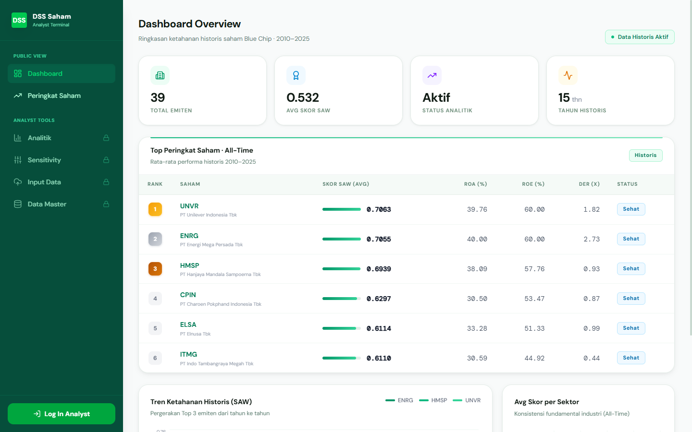
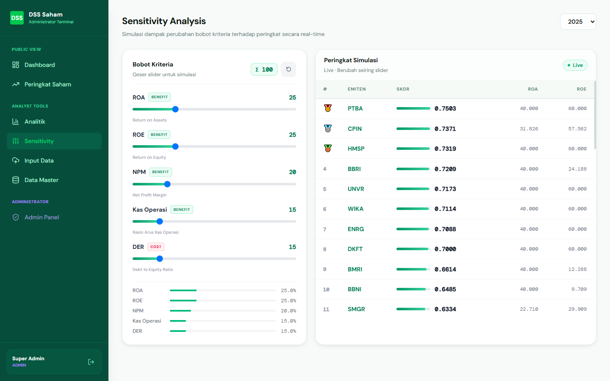
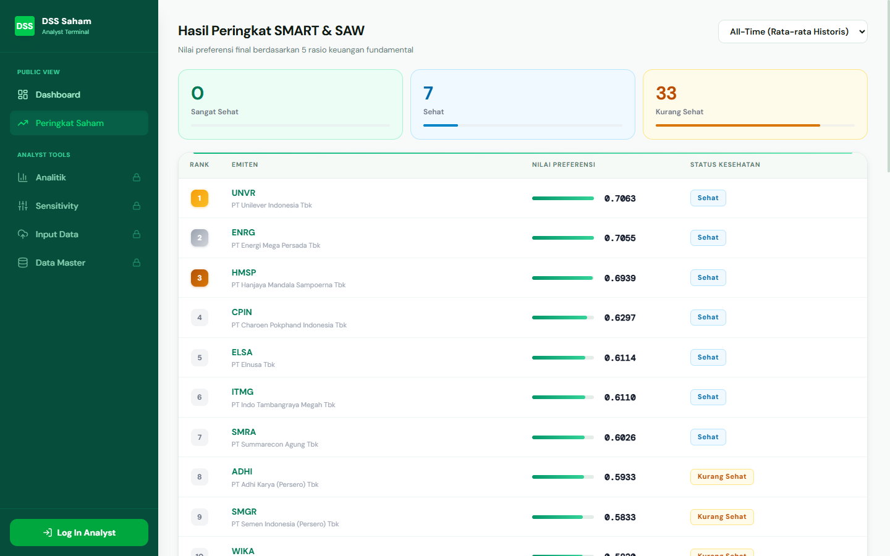
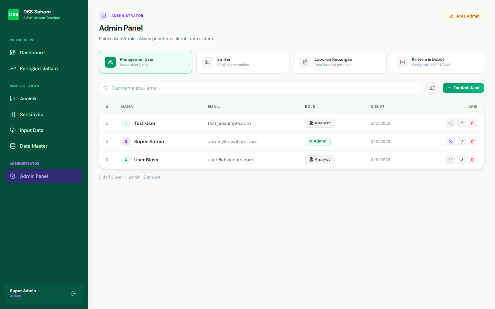

# 📈 DSS Saham (Decision Support System Pemeringkatan Saham BEI)

[](LICENSE)
[](https://laravel.com)
[](https://react.dev)
[](https://tailwindcss.com)
[](backend)
[](backend)

> **Sistem Pendukung Keputusan (SPK / DSS) Berbasis Sains untuk Pemeringkatan Kinerja Fundamental Saham Blue-Chip di Bursa Efek Indonesia (IDX) Menggunakan Metode SMART & SAW.**

---

## 📌 Ringkasan Eksekutif

**DSS Saham** adalah aplikasi analitis kuantitatif yang dirancang untuk mengeliminasi bias emosional dan subjektif dalam pemilihan saham. Dengan memadukan metode **SMART (Simple Multi-Attribute Rating Technique)** untuk pembobotan kriteria dan **SAW (Simple Additive Weighting)** untuk perankingan alternatif, sistem ini mengolah rekam jejak fundamental emiten selama **15 tahun historis (2010–2025)** untuk menghasilkan peringkat emiten yang transparan, teruji secara matematis, dan dapat dipertanggungjawabkan.

---

## ✨ Fitur Utama

### 🌐 1. Tampilan Publik (Tanpa Login)
- **Dashboard Overview:** Ringkasan statistik pasar, rata-rata skor SAW, visualisasi tren pergerakan Top 3 emiten historis (*AreaChart*), dan konsistensi fundamental per sektor industri (*BarChart*).
- **Peringkat Saham Multi-Periode:** Filter pemeringkatan saham per tahun buku (2010–2025) atau All-Time (rata-rata historis), lengkap dengan skor preferensi ($V_i$) dan badge status kesehatan (*Sangat Sehat*, *Sehat*, *Kurang Sehat*).
- **Screener Saham (Value Investing):** Analisis valuasi fundamental emiten (EPS, BVPS, PER, PBV, ROE, DER) dengan visualisasi warna berbasis parameter *Value Investing*.

### 🔬 2. Terminal Analis (Role: `user` & `admin`)
- **Simulasi Sensitivitas Real-Time:** Slider interaktif untuk menyesuaikan bobot ke-5 kriteria secara langsung di peramban, dengan kalkulasi ulang matriks SMART & SAW instan di sisi klien (*Client-side Compute*).
- **Batch Processing Historis:** Pipeline 2 langkah untuk kalkulasi rasio otomatis dari laporan keuangan terverifikasi dan generate perangkingan multi-tahun dengan *Outlier Clamping Guard*.
- **Visualisasi Komparatif:** Analisis radar perbandingan rata-rata kinerja rasio antara kelompok Top-5 vs Bottom-5 emiten, serta diagram lingkaran distribusi kesehatan industri.

### 🛡️ 3. Panel Administrator (Role: `admin`)
- **Manajemen Pengguna (RBAC):** Kontrol akun pengguna (Admin/User), pencarian, reset password, dan proteksi anti-hapus akun sendiri.
- **Kurasi Laporan Keuangan:** Manajemen siklus hidup data (*Draft* ➔ *Direview* ➔ *Dipublikasi*) dengan pengamanan transaksi database atomik (`DB::transaction`).
- **Kelola Emiten & Master Kriteria:** CRUD emiten per sektor industri dan konfigurasi bobot kriteria dengan normalisasi SMART global.

---

## 🧮 Metodologi SPK (SMART & SAW)

Sistem mengevaluasi emiten menggunakan 5 kriteria rasio fundamental utama:

| Kode | Kriteria | Sifat Atribut | Bobot Default | Formula Rasio |
| :---: | :--- | :---: | :---: | :--- |
| **C1** | Return on Assets (ROA) | **Benefit** | 25% | $\frac{\text{Laba Bersih}}{\text{Total Aset}} \times 100\%$ |
| **C2** | Return on Equity (ROE) | **Benefit** | 25% | $\frac{\text{Laba Bersih}}{\text{Total Ekuitas}} \times 100\%$ |
| **C3** | Net Profit Margin (NPM) | **Benefit** | 20% | $\frac{\text{Laba Bersih}}{\text{Pendapatan}} \times 100\%$ |
| **C4** | Rasio Arus Kas Operasi | **Benefit** | 15% | $\frac{\text{Arus Kas Operasi}}{\text{Total Aset}}$ |
| **C5** | Debt to Equity Ratio (DER) | **Cost** | 15% | $\frac{\text{Total Liabilitas}}{\text{Total Ekuitas}}$ |

### Rumus Algoritma:
1. **Normalisasi Bobot SMART:**  
   $$W_j = \frac{w_j}{\sum_{k=1}^m w_k}$$
2. **Normalisasi Matriks Keputusan SAW:**  
   - Kriteria *Benefit*: $r_{ij} = \frac{x_{ij}}{\max(x_{kj})}$ *(diberi floor 0 untuk mencegah skor negatif)*  
   - Kriteria *Cost*: $r_{ij} = \frac{\min(x_{kj})}{x_{ij}}$ *(diberi floor DER 0.05 untuk mencegah singularitas pembagi mendekati nol)*
3. **Nilai Preferensi Akhir ($V_i$):**  
   $$V_i = \sum_{j=1}^m W_j \cdot r_{ij}$$

---

## 📸 Antarmuka Pengguna (UI Preview)

| Dashboard Analisis Historis | Simulasi Sensitivitas Bobot |
| :---: | :---: |
|  *(Placeholder: Tampilan grafik tren & skor emiten)* |  *(Placeholder: Slider interaktif bobot kriteria)* |

| Hasil Peringkat Multi-Tahun | Admin Terminal |
| :---: | :---: |
|  *(Placeholder: Tabel skor preferensi & status)* |  *(Placeholder: Manajemen laporan & user)* |

---

## 🛠️ Tech Stack

- **Backend:**
  - **Framework:** Laravel 12.x (PHP 8.2+)
  - **Autentikasi:** Laravel Sanctum (Token-based dengan kedaluwarsa 24 jam)
  - **Database:** SQLite / MySQL / MariaDB (Dukungan database ganda)
  - **Pengujian:** PHPUnit 11 (Unit & Feature Testing)
  - **Code Standard:** Laravel Pint (PSR-12)
- **Frontend:**
  - **Framework:** React 19 + Vite 8
  - **Routing:** React Router DOM 7
  - **Styling:** Tailwind CSS 4, Radix UI Primitives, Lucide React
  - **Visualisasi Data:** Recharts 3.8 (AreaChart, BarChart, RadarChart, PieChart)
  - **Notifikasi:** react-hot-toast
  - **Code Quality:** ESLint + Prettier

---

## 🚀 Panduan Instalasi & Menjalankan Proyek

### Prasyarat
- **PHP** >= 8.2 & **Composer**
- **Node.js** >= 20.x & **npm**

---

### 1. Setup Backend (Laravel)

```bash
# Masuk ke direktori backend
cd backend

# Pasang dependensi PHP
composer install

# Siapkan berkas environment
cp .env.example .env

# Generate application key
php artisan key:generate

# Jalankan migrasi basis data & seeder
php artisan migrate --seed

# Jalankan server API backend (berjalan di http://localhost:8000)
php artisan serve
```

> **Catatan Seeder:** Secara default, seeder akan membuat akun awal:
> - Super Admin: `admin@dssaham.com` / `password123`
> - User Biasa: `user@dssaham.com` / `password123`
> - Data historis 39 emiten (2010–2025) otomatis terisi dari `data_saham_siap_pakai.csv`.

---

### 2. Setup Frontend (React + Vite)

Buka terminal baru:

```bash
# Masuk ke direktori frontend
cd frontend

# Pasang dependensi Node.js
npm install

# Siapkan berkas environment
cp .env.example .env

# Jalankan server development (berjalan di http://localhost:5173)
npm run dev
```

Buka peramban di `http://localhost:5173`.

---

## 🧪 Pengujian & Pemeriksaan Kode

```bash
# ── Backend ──
cd backend
composer run test        # Menjalankan PHPUnit (12 tests passed)
composer run lint        # Memeriksa standar kode dengan Laravel Pint
composer run format      # Memformat kode otomatis

# ── Frontend ──
cd frontend
npm run lint             # Menjalankan ESLint
npm run format:check     # Memeriksa formatting Prettier
npm run build            # Verifikasi build produksi Vite
```

---

## 📁 Struktur Direktori Proyek

```
dss-saham/
├── .github/workflows/         # CI Pipeline (GitHub Actions lint & test)
├── docs/
│   ├── PRD.md                 # Product Requirements Document lengkap
│   ├── AUDIT.md               # Laporan audit & log perbaikan temuan
│   └── screenshots/           # Screenshot antarmuka aplikasi
├── backend/
│   ├── app/
│   │   ├── Http/Controllers/  # Controller API (Admin, Analitik, Auth, Master, Draft)
│   │   ├── Http/Middleware/   # Middleware otorisasi (IsAdmin)
│   │   ├── Models/            # Eloquent Models (Emiten, Laporan, Kriteria, Peringkat)
│   │   └── Services/          # Dedicated DSS Services (SmartSawService, RatioService)
│   ├── database/
│   │   ├── migrations/        # 9 berkas skema migrasi tabel
│   │   ├── seeders/           # Seeder kriteria default, user, dan import CSV
│   │   └── dss_saham_db.sql   # Cadangan dump SQL terkurasi
│   ├── routes/
│   │   └── api.php            # Rute REST API terproteksi Sanctum & IsAdmin
│   └── tests/                 # Unit & Feature Test Suite
└── frontend/
    ├── src/
    │   ├── components/        # Komponen modular (MainLayout, ProtectedRoute, Screener)
    │   ├── contexts/          # AuthContext (Sesi & Token Auth)
    │   ├── pages/             # Halaman aplikasi (Dashboard, Peringkat, Analitik, Admin, dll)
    │   └── services/          # HTTP Client Axios & API Base terpusat
    └── package.json
```

---

## 🗺️ Roadmap Pengembangan

- [x] **Fase 1:** Implementasi inti algoritma SMART & SAW historis 15 tahun.
- [x] **Fase 2:** Simulasi interaktif sensitivitas bobot (*Client-Side Engine*).
- [x] **Fase 3:** Refactoring arsitektur service (`RatioService` & `SmartSawService`), perbaikan keamanan otorisasi & sanitasi matematika SAW.
- [ ] **Fase 4:** Integrasi otomatisasi Vision AI / OCR untuk pembacaan dokumen laporan keuangan PDF resmi BEI.
- [ ] **Fase 5:** Penambahan metrik valuasi DCF (*Discounted Cash Flow*) dan fitur perbandingan *Head-to-Head* antar-emiten satu sektor.

---

## 📄 Lisensi & Kontribusi

Proyek ini dilisensikan di bawah lisensi **MIT** — silakan baca berkas [LICENSE](LICENSE) untuk rincian lengkap.  
Tertarik untuk berkontribusi? Silakan baca panduan di [CONTRIBUTING.md](CONTRIBUTING.md).

---

**Dikembangkan oleh:** Wildan — Sistem Pendukung Keputusan & Analisis Kuantitatif Pasar Modal Indonesia.
